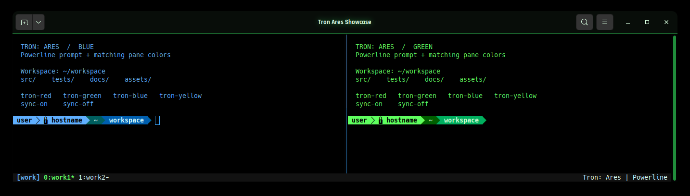
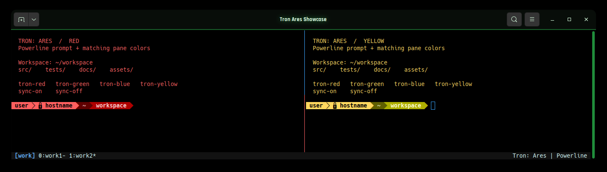
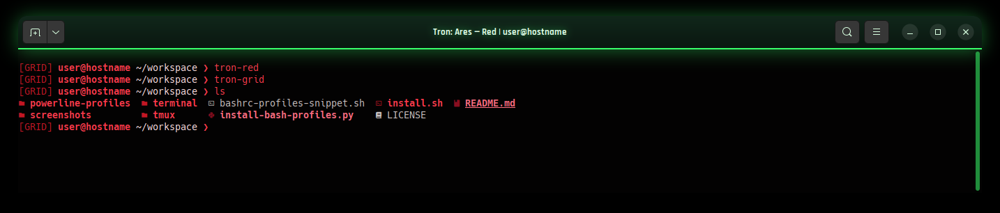

# Tron: Ares Terminal

Four neon terminal themes with matching Bash Powerline prompts and a reusable,
four-pane tmux workspace. Built for GNOME Terminal on Ubuntu; the desktop GTK
theme is unchanged.

> This setup was AI-generated and works on my computer. It has been tested locally;
> other systems may need adjustments.





Screenshots show a sample workspace captured on my computer with Hack Nerd Font
Mono and generic user/host labels. The shared profiles use the packaged Powerline font.
The red GRID listing uses optional `eza` for file icons; this setup does not install it.

## Install

Start in a terminal in your Ubuntu GNOME desktop session.

1. Install Git and the required packages:

   ```bash
   sudo apt update
   sudo apt install git python3 gnome-terminal tmux powerline fonts-powerline fontconfig dconf-cli
   ```

2. Clone this repository and enter its folder:

   ```bash
   git clone https://github.com/bigg01/tron-ares-terminal.git
   cd tron-ares-terminal
   ```

3. Run the installer as your regular user:

   ```bash
   ./install.sh
   ```

Only the package installation needs `sudo`; do not run `install.sh` with `sudo`.
If you downloaded the repository as a ZIP instead, extract it, enter the extracted
folder, and run `bash install.sh` after installing the prerequisites.

Run this as your regular user in a graphical desktop session. The installer adds
**Tron: Ares — Green**, **Red**, **Blue**, and **Yellow** profiles, configures Bash,
and installs `~/.local/bin/tmux-work`. It keeps the default terminal profile.
Existing Bash, terminal, Powerline profile, and launcher settings are backed up
before replacement. Reinstalling updates the same four named terminal profiles.

Profiles use **DejaVu Sans Mono for Powerline**, supplied by `fonts-powerline`.
You can select Hack Nerd Font Mono in Terminal Preferences if installed.

Open a new terminal with the desired profile, or load the Bash aliases:

```bash
source ~/.bashrc
```

Try `tron-blue` to switch colors, then run `tmux-work` to launch the grouped
workspace. The installer adds `~/.local/bin` to Bash's PATH when the snippet is loaded.

## Change colors

```bash
tron-red
tron-green
tron-blue
tron-yellow
```

The aliases switch the current Powerline prompt, window title, foreground,
background, cursor, and ANSI palette. They do not change saved GNOME profiles.
In tmux, the current pane's prompt and foreground/background change; other panes
keep their colors. The terminal's shared palette and cursor stay unchanged.
The outer title bar and border follow GNOME's shared GTK theme.

## Choose a prompt style

Powerline is the default. Switch to the minimal, movie-inspired GRID style or back
without changing your terminal color:

```bash
tron-grid       # [GRID] user@host ~/project ❯
tron-powerline  # colored Powerline segments
```

Both styles support all four colors. For example, `tron-red` followed by
`tron-grid` gives a red GRID prompt; `tron-blue` changes it to blue while keeping
GRID mode. The aliases apply to the current Bash shell or tmux pane. GRID mode
preserves other prompt hooks, such as tmux working-directory updates.

To make GRID your default, add this line to `~/.bashrc` **before** the
`# --- Tron: Ares selectable Bash profiles ---` block:

```bash
export TRON_ARES_PROMPT=grid
```

Use `powerline` instead, or remove that line, to restore the default. To try GRID
in a new shell without changing your default:

```bash
TRON_ARES_THEME=red TRON_ARES_PROMPT=grid bash
```

## Using tmux

A **session** is a workspace that keeps shells running while you detach. A
**window** groups panes, like a tab; a **pane** is one shell in a split window.
This setup creates the `work` session with four panes in two windows.

### Start and choose a group

Run these commands in your terminal:

```bash
tmux-work                       # start in your home directory
tmux-work "$HOME/projects/app"  # use an existing project directory
```

| Window / group | Left pane | Right pane |
|---|---|---|
| `work1` | Blue | Green |
| `work2` | Red | Yellow |

Running the launcher again reattaches to `work`; from inside tmux, it switches
sessions. Existing layouts, commands, and working directories stay intact.
Directory arguments apply when creating a session. For another named workspace:

```bash
TMUX_WORK_SESSION=personal tmux-work "$HOME"
```

Set `TMUX_WORK_DIR` for a default directory. Each pane starts as a shell; run
your editor, server, or monitoring command in the pane you want to use.

### Navigate and manage panes

For each shortcut, hold **Ctrl** and press **B**, release both, then press the
listed key. Example: **Ctrl+B**, then **w** opens the window chooser. These are
tmux's default bindings; an existing `~/.tmux.conf` can override them.

| Key after Ctrl+B | Action |
|---|---|
| `w` | Choose a window/group |
| `n` / `p` | Next / previous window |
| Arrow | Move to a neighboring pane |
| `o` | Move to the next pane |
| `%` | Split side by side |
| `"` | Split top and bottom |
| `z` | Expand the current pane / restore the layout |
| Ctrl+Arrow | Resize the pane; repeat for a larger change |
| `c` | Create another window |
| `,` | Rename the current window |
| `!` | Move the current pane into its own window |
| `[` | Enter scroll/copy mode; use arrows or Page Up, then `q` to leave |
| `d` | Detach while leaving shells running |
| `?` | Show the shortcut list |

Type `exit` at a shell prompt to close that pane. Closing the last pane closes
its window; closing the last window ends the session.

To add a pane with a specific color and the current pane's directory:

```bash
tmux split-window -h -c "#{pane_current_path}" 'env TRON_ARES_THEME=red bash'
```

Run `tron-red`, `tron-green`, `tron-blue`, or `tron-yellow` inside a pane to change
its prompt and default foreground/background. Use `tron-grid` or
`tron-powerline` to choose its prompt style.

### Synchronize a group

At a shell prompt inside tmux, run:

```bash
sync-on   # send your typing to all panes in this window
sync-off  # return to independent typing
```

Synchronization affects the selected window, so `work1` and `work2` can be
controlled independently. Target panes should be at shell prompts when sending
shell commands; turn synchronization off before working in one pane alone.
Check the current setting with `tmux show-window-options synchronize-panes`.

### Detach and return

Press **Ctrl+B**, then **d**. Your shells and programs continue running. Return
with `tmux-work`, or list and attach to sessions manually:

```bash
tmux list-sessions
tmux attach-session -t work
```

From inside tmux, use `tmux switch-client -t work` instead of attaching another
client. Detaching preserves the live session; it does not save it across a reboot.

### Optional mouse controls

Run `tmux set-option mouse on` inside the session to click panes and window names,
resize by dragging borders, and scroll with the mouse. Use
`tmux set-option mouse off` to disable it. For a default across future sessions,
add `set -g mouse on` to `~/.tmux.conf`.

See the [official tmux getting-started guide](https://github.com/tmux/tmux/wiki/Getting-Started)
for more controls and customization.

## Files and customization

- `bashrc-profiles-snippet.sh`: color switching, Powerline setup, and sync aliases.
- `powerline-profiles/<color>/`: per-shell RGB colors and prompt segments.
- `terminal/`: four GNOME Terminal profile definitions.
- `tmux/tmux-work`: grouped session launcher.
- `screenshots/`: actual GNOME Terminal captures of both groups.

Powerline shows user, host, virtual environment, Git branch when available,
working directory, background jobs, and failed-command status. Each shell has
its own configuration under `${XDG_CONFIG_HOME:-$HOME/.config}/tron-ares/powerline/`,
so multiple colors can run simultaneously. Edit source files and rerun the
installer to apply changes; tmux layout changes apply to newly created sessions.

## Restore backups

The installer prints timestamped Bash and GNOME Terminal backup paths. Copy the
chosen `.bashrc.bak.tron-profiles.*` file back to `~/.bashrc`. Restore terminal
settings with `dconf load /org/gnome/terminal/legacy/ < BACKUP.dconf`.
Restore any previous launcher from `~/.local/bin/tmux-work.bak.*` and profile
configuration from the adjacent `powerline.bak.*` directory if needed.


## License and warranty

Licensed under the [MIT License](LICENSE). This setup is provided **AS IS,
without warranty of any kind**. There is no guarantee of compatibility,
reliability, or fitness for any purpose. Use it at your own risk; see the license
for the full warranty disclaimer and limitation of liability.

Third-party dependencies remain subject to their own licenses.
